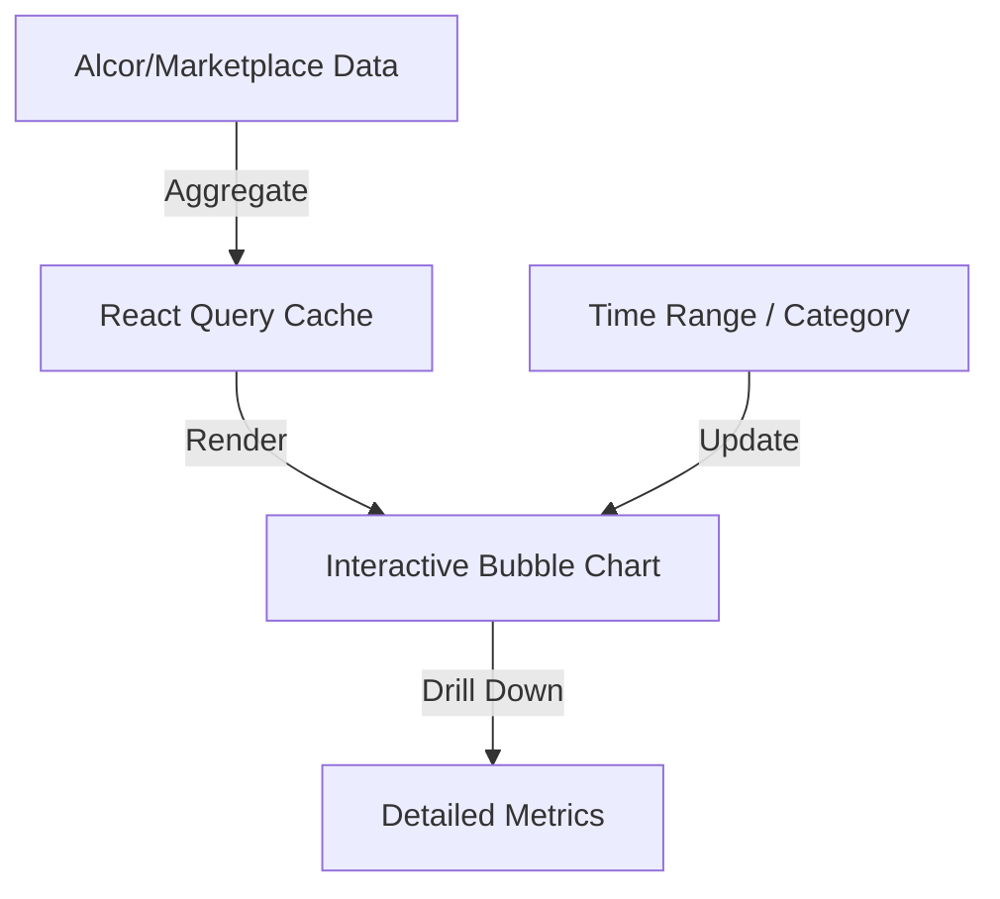

# wax-market-cap-bubble — Market Cap Bubble Chart & Liquidity Visualizer

> **Status:** 🔒 Private (In Development) | Target Public Release: August 2026  
> **Category:** Alcor & DeFi Visualizers / Marketplace & Analytics  
> **Parent Catalog:** [pixel-journey/wax-ecosystem-blueprint-catalog](https://github.com/pixel-journey/wax-ecosystem-blueprint-catalog)

**One-sentence goal:** An interactive bubble chart visualizer that displays market cap, trading volume, liquidity depth, and price dynamics for collections and assets, giving instant insight into ecosystem health and opportunities on WAX.

---

## 1. Overview & Goal

This blueprint turns complex market data into a beautiful, interactive bubble chart that reveals size, activity, and liquidity at a glance.

- **Why it matters for WAX:** Market overview is essential for collectors and traders. Beautiful visualization helps spot trends, opportunities, and risks quickly.
- **Public infrastructure only:** Marketplace and Alcor public data for caps, volume, and liquidity, client-side rendering. No custom contracts.
- **Target users:** Collectors, traders, analysts, new users exploring the ecosystem.
- **Success metrics:** "See market overview and key metrics in <3s", "Interactive bubbles with drill-down", "Clear liquidity and volume signals".

---

## 2. Concepts & Inspiration

- **Core concepts:** Bubble size = market cap or volume, position or color = price change or liquidity, clustering by category. Client aggregates and renders interactively.
- **Pain points:** Raw tables or simple lists don't convey relationships or scale. Users want beautiful, instant visual insight.
- **Inspirations:** Financial bubble charts in analytics tools (e.g. Dune, TradingView), modern data viz dashboards. Web3: on-chain market transparency + beautiful viz.
- **Cross-references:** Perfect with other Alcor/DeFi visualizers (royalty pie, LP behavioral profiler, high-frequency position monitor) and marketplace analytics.

---

## 3. Design Specifications (Pixel Journey Standards)

### 3.1 Visual & Interaction Design
- Clean, modern bubble chart with elegant sizing, positioning, and subtle animations.
- Sidebar or tooltip: Detailed metrics for selected bubble (cap, volume, liquidity, 24h change).
- Interactions: Hover for details, click to drill into collection, zoom/pan, time range filter.
- Micro-interactions: Gentle bubble pulsing on volume spikes, smooth transitions on filter changes.
- Responsive: Excellent on desktop; mobile-friendly summary or simplified bubbles.

### 3.2 Key Views / Components
- `MarketCapBubbles.tsx` — Main interactive bubble chart.
- `MetricsSidebar.tsx` — Live KPIs and selected bubble details.
- `TimeRangeFilter.tsx` — Clean controls for historical views.
- `CategoryLegend.tsx` — Clear legend for bubble groupings.
- `ExportPanel.tsx` — Export chart or data.

### 3.3 Accessibility (A11y) & Inclusive Design
- WCAG 2.2 AA: High contrast bubbles with patterns, keyboard navigation, screen reader descriptions of bubbles and metrics.
- Data table fallback for all visualizations.
- Colorblind-safe palettes.

### 3.4 Performance & Optimization Targets
- Efficient data aggregation with caching.
- Fast bubble rendering (Recharts or custom Canvas/SVG).
- Responsive design with progressive enhancement.

---

## 4. Technical Architecture

### 4.1 Core Tech Stack
- Next.js 15 + TypeScript + Tailwind + shadcn/ui + Recharts or custom SVG/Canvas
- @tanstack/react-query
- Alcor and marketplace public endpoints for cap, volume, liquidity data
- AtomicAssets for collection metadata
- date-fns for time handling

### 4.2 Data Flow Diagram


### 4.3 Folder Structure
```
app/
├── (dashboard)/page.tsx
├── components/
│   ├── bubbles/
│   │   └── MarketCapBubbles.tsx
│   ├── metrics/
│   │   └── MetricsSidebar.tsx
│   └── filters/
│       └── TimeRangeFilter.tsx
├── hooks/useMarketData.ts
├── lib/wax/
│   ├── market-aggregator.ts
│   └── bubble-utils.ts
└── types/market.ts
```

### 4.4 Security & Privacy
- Purely public data. No PII.

---

## 5. Implementation Examples & Code Snippets

**Core market data hook**
```ts
// hooks/useMarketData.ts
export function useMarketData(timeRange: string) {
  return useQuery({
    queryKey: ['market-bubbles', timeRange],
    queryFn: async () => {
      const data = await fetchMarketData(timeRange);
      return prepareBubbleData(data);
    }
  });
}
```

**Bubble rendering**
```tsx
<MarketCapBubbles data={bubbleData} onBubbleClick={drillDown} />
```

---

## 6. Demo & Testing
- Mock data with realistic market dynamics.
- Live mode with real marketplace data.
- Interaction tests: hover, click, filters, zoom.
- Performance tests for large datasets.

---

## 7. Roadmap
Phases: Data aggregation and bubble preparation → Core chart UI with interactions → Polish, a11y, export → full documentation.

Future: 3D bubbles, correlation views, integration with other DeFi visualizers.

---

## 8. Visual References
> Clean financial bubble charts like those in modern analytics dashboards. Elegant sizing, clear interactions, professional yet approachable. Reference: high-quality financial visualization tools.

---

## 9. Related Blueprints
- Other Alcor & DeFi visualizers (royalty pie, LP behavioral profiler, high-frequency position monitor).
- Marketplace analytics tools.

---

## 10. License & Credits
MIT. Built for beautiful market overview on WAX.

**Pixel Journey — Beautiful interfaces for public blockchain data.**
